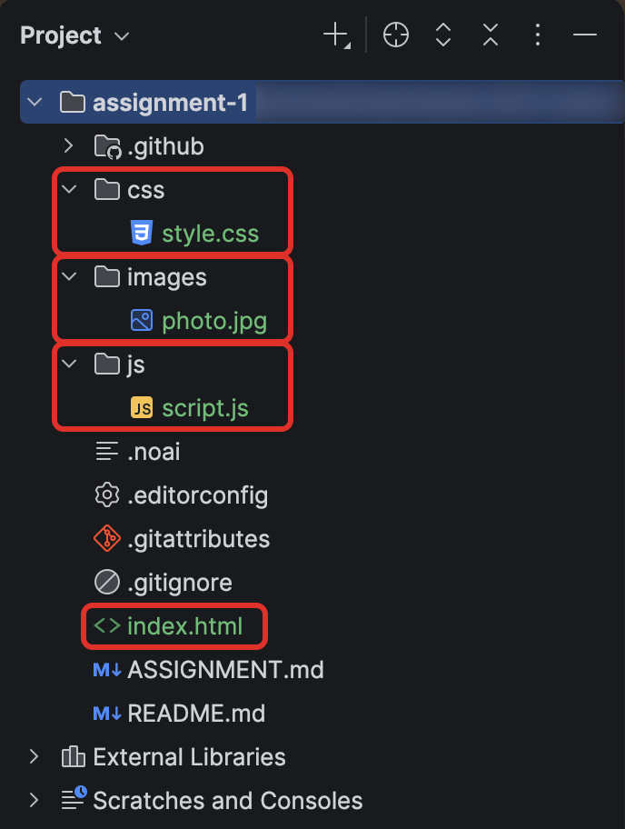

# 🌙 The Professor Who Walked on the Moon

A typography exercise for Web Design I. The article about Neil Armstrong's years teaching at the University of
Cincinnati is already written and laid out. You'll style its type in `css/typography.css`: fonts, sizes, weights, line
heights and a few splashes of color.

> [!NOTE]
> `.editorconfig`, `.gitattributes`, `.gitignore`, `.noai`, and the `.github` and `.idea`
> folders are setup files that keep assignments consistent. Leave them alone.

## 📋 Assignment Requirements

> [!IMPORTANT]
> **Start here: [read ASSIGNMENT.md →](.github/ASSIGNMENT.md)**

It has the requirements, grading criteria, and due date. Read it before you start, and check it again before you submit.

## ✅ At a Glance

Every assignment follows the same steps. Each guide has screenshots for every step.

| Step | What you do                                                                | Guide                                         |
|------|----------------------------------------------------------------------------|-----------------------------------------------|
| 0    | **First assignment only:** install and set up WebStorm                     | [WebStorm Setup](.github/WEBSTORM_SETUP.md)   |
| 1    | Create your repo from this template, clone it, and make a `develop` branch | [Getting Started](.github/GETTING_STARTED.md) |
| 2    | Create `css/typography.css`, link it in `index.html`, and style the page   | [Where Your Files Go](#-where-your-files-go)  |
| 3    | Commit and push often, then turn on GitHub Pages                           | [Publishing](.github/PUBLISHING.md)           |
| 4    | Open a pull request into `main` and submit its URL in Canvas               | [Submitting](.github/SUBMITTING.md)           |

## 📂 Where Your Files Go

The starter files are already in the **root folder** of this repo, the same folder as this README. GitHub Pages
publishes from the root, so leave `index.html` where it is or your site will 404.

```
index.html               ← add your <link> tags here, nothing else
css/
  base.css               ← layout and spacing; don't edit
  typography.css         ← you create this; all of your work goes here
images/
  professor-armstrong.webp
  final.png              ← example of a finished page
```

In general, keep `index.html` in the root and group assets into subfolders:



## 🤖 AI Policy

Work on this assignment must be your own. Do not use AI coding assistants — including
GitHub Copilot, Cursor, ChatGPT, Claude, or JetBrains AI Assistant — to generate,
complete, or rewrite your code.

You should be able to explain any line of your submission. You may be asked to do so.

This repo includes a `.noai` file, which disables JetBrains AI Assistant for the project
in IDEs like WebStorm. Leave it in place. It is a reminder of the policy above, not a
substitute for it — following the policy is still your responsibility.

> [!NOTE]
> The `.noai` file does **not** turn off WebStorm's local Full Line code completion. Turn that
> off yourself as part of the [one-time setup](.github/WEBSTORM_SETUP.md) (step 5).

> [!CAUTION]
> Late or missing submissions are graded on what is in the pull request at the deadline, so push your final commits
> before you submit.
